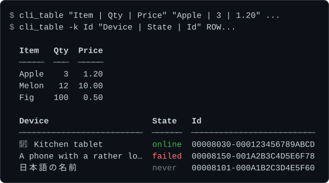
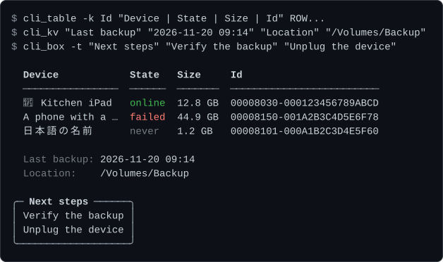
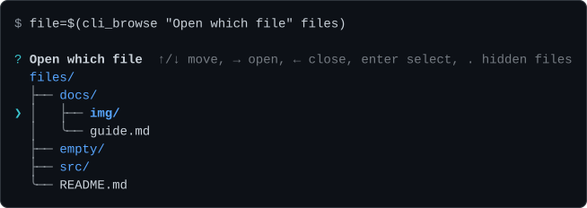
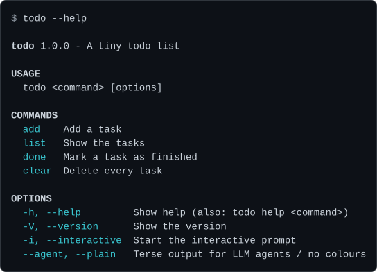
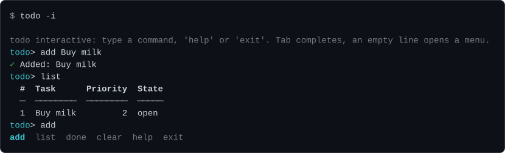
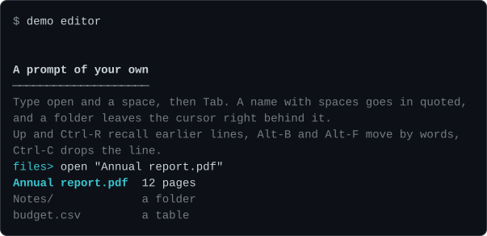

# clikit

Command-line output that adapts to whoever is reading it, for more than one language.


| Reader | Gets |
|---|---|
| a person at a terminal | colours, symbols, progress bars, spinners, timelines, trees, arrow-key menus, a file browser |
| a pipe, a log file, CI | the same words without escape codes or animation |
| both at once (`tool > file`) | plain content in the file, colours and live bars at the terminal |
| an LLM agent | only what is needed, in as few tokens as possible |

```
rich                                      plain                 agent
✓ Built                                   [OK] Built            ok: Built
⠹ Copying ████████████░░░░░░░░░░  50%     Copying: 50% (2/4)    (nothing yet)
✓ Copying (4/4, 1.1s)                     Copying: 100% (4/4)   Copying: 4/4 1.1s
❯ staging                                 choice [staging]:     Deploy to: staging
  production
```

## Features

Every picture is drawn by [`docs/render.py`](docs/render.py) from what the code prints at a
terminal, so it shows the real thing. The ones that move are recordings of a run as it happened,
the keys that were typed and their timing included. The Rust crate prints the same bytes as the
shell functions named in the pictures.

### Status lines and steps


Info, ok, warning, error, numbered steps, hints. They go to standard error, so they never mix
with a program's output, and they appear above a live bar, not through it.

### Progress bar and spinner


A bar for work that can be counted, a spinner around a command. Finished work becomes one
line with the time it took; a command's output shows only when it fails.

### Several tasks under one total


The stages of a job one after the other (the animation at the top of this page), or tasks side
by side. Each task can show sizes, its speed and the time left, or only a percentage and a
note; it can fail or be skipped; weights say how much of the total each one is.

### Tables



Columns align themselves, numbers to the right. Cells may be coloured, emoji and CJK text keep
the columns straight, and when the terminal is too narrow a column you name is never cut.

### Headers, lists, key-values, boxes



The small pieces most output is made of.

### Timelines


Events on tracks: along an axis that fits the terminal, or one row per event, as long as it
needs to be. A track is anything: a device, a branch, a photo album.

### Trees


From a list of paths, or from the files on disk.

### File browser



Walk through a tree with the arrow keys and pick a file or a directory: the files on disk, or
any list of paths, such as the contents of an archive.

### Questions


Menus, several choices, yes or no, text with suggestions, a hidden password. Escape goes back
one question. They work while the program's output is piped, and without a terminal they read
a line of standard input.

### Commands and help pages



Declare commands and options; parsing, help pages and error messages follow. In Rust the same
comes on top of clap.

### Interactive prompt



Any program with commands gets a prompt that runs them: Tab completion, history, Ctrl-C to
drop a line.

### A line editor for a prompt of your own



For a program that is a shell itself (Rust): completion from your program with a list of what
each candidate is, names with spaces quoted for you, history kept in a file, Ctrl-R, long lines.

### And the small things

Durations (`3m 07s`), sizes (`27.9 GB`), stopwatches, the terminal's width, whether colours are on.

## Implementations

| Language | Where | Use it for | Install |
|---|---|---|---|
| Shell (bash 3.2+, zsh 5.3+) | [`sh/`](sh/README.md) | scripts | copy `sh/cli.sh`, then `. ./cli.sh` |
| Rust (1.75+) | [`rust/`](rust/README.md) | programs, with or without clap | a git dependency on this repository |

Both print the same bytes for the same call. [`SPEC.md`](SPEC.md) is the contract, and
[`conformance/cases.txt`](conformance/cases.txt) holds 432 cases that both test suites run.

## Try it

```sh
sh/examples/demo.sh                                    # shell: a menu of every feature
cd rust && cargo run --features clap --example demo    # Rust: the same
```

Add `all` to run everything, `mock` for a pretend release that uses most features together, and
`CLI_AGENT=1` in front to see what an agent gets.

## Tests

```sh
sh/test/all.sh                              # shell: unit tests and conformance, in every shell found
cd rust && cargo test --all-features        # Rust: conformance, clap integration, API, doc tests
python3 conformance/terminal.py             # both, in a real terminal: Ctrl-C leaves it as it was
python3 docs/render.py                      # draw the pictures above again, from the shell implementation
```

## Adding a language

Read `SPEC.md`, write a driver for `conformance/cases.txt`, and make every case pass.
