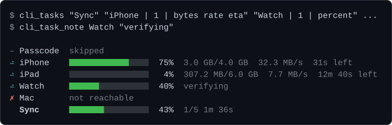
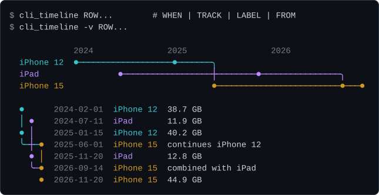
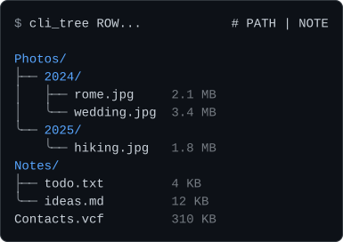

# clikit

Command-line output that adapts to whoever is reading it, for more than one language.


| Reader | Gets |
|---|---|
| a person at a terminal | colours, symbols, progress bars, spinners, timelines, trees, arrow-key menus, a file browser |
| a pipe, a log file, CI | the same words without escape codes or animation |
| an LLM agent | only what is needed, in as few tokens as possible |

```
rich                                      plain                 agent
✓ Built                                   [OK] Built            ok: Built
⠹ Copying ████████████░░░░░░░░░░  50%     Copying: 50% (2/4)    (nothing yet)
✓ Copying (4/4, 1.1s)                     Copying: 100% (4/4)   Copying: 4/4 1.1s
❯ staging                                 choice [staging]:     Deploy to: staging
  production
```

## What it looks like

At a terminal. Every picture is drawn by [`docs/render.py`](docs/render.py) from what the code
prints, so it shows the real thing; the Rust crate prints the same bytes.

Status lines, numbered steps, a spinner's result, a progress bar:


Tasks that run at the same time, under one total:



Tables, key-value lines, boxes:


Timelines: events on tracks along a time axis, or one row per event:



Trees of paths or files, and a browser to walk through them:




Questions: menus, yes or no, several choices:


Help pages, written from the commands and options a program declares:


## Implementations

| Language | Where | Use it for | Install |
|---|---|---|---|
| Shell (bash 3.2+, zsh 5.3+) | [`sh/`](sh/README.md) | scripts | copy `sh/cli.sh`, then `. ./cli.sh` |
| Rust (1.75+) | [`rust/`](rust/README.md) | programs, with or without clap | a git dependency on this repository |

Both print the same bytes for the same call. [`SPEC.md`](SPEC.md) is the contract, and
[`conformance/cases.txt`](conformance/cases.txt) holds 393 cases that both test suites run.

## Try it

```sh
sh/examples/demo.sh                                    # shell: a menu of every feature
cd rust && cargo run --features clap --example demo    # Rust: the same
```

Add `all` to run everything, `mock` for a pretend release that uses most features together, and
`CLI_AGENT=1` in front to see what an agent gets.

## Tests

```sh
sh/test/all.sh                              # shell: unit tests and conformance, in every shell found
cd rust && cargo test --all-features        # Rust: conformance, clap integration, API, doc tests
python3 conformance/terminal.py             # both, in a real terminal: Ctrl-C leaves it as it was
python3 docs/render.py                      # draw the pictures above again, from the shell implementation
```

## Adding a language

Read `SPEC.md`, write a driver for `conformance/cases.txt`, and make every case pass.
