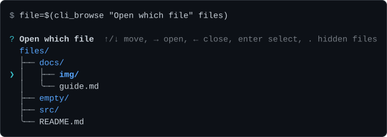

# clikit

Command-line output for Rust programs that adapts to whoever is reading it: colour and animation
for a person at a terminal, plain words for a log file, and the fewest tokens that carry the
information for an LLM agent.

- No dependencies. `clap` is optional, behind a feature.
- No `unsafe`.
- Rust 1.75 or later.
- Prints the same bytes as the shell implementation in `../sh`; both run `../conformance/cases.txt`.

## Install

```toml
[dependencies]
clikit = { git = "<this repository>", rev = "<commit>" }
# with the clap integration:
clikit = { git = "<this repository>", rev = "<commit>", features = ["clap"] }
```

## A first program

```rust
use std::process::Command;
use clikit as cli;

fn main() -> Result<(), Box<dyn std::error::Error>> {
    cli::require(&["git", "tar"]);

    cli::steps(3);
    cli::step("Fetch");
    cli::spin_command("Pulling the latest changes", Command::new("git").args(["pull", "--quiet"]))?;

    cli::step("Pack");
    let files = ["a.rs", "b.rs", "c.rs"];
    let mut bar = cli::Progress::new(files.len() as u64, "Packing");
    for _file in files {
        bar.inc();
    }

    cli::step("Ship");
    let target = cli::select("Deploy to", &["staging", "production"], Some("staging"))?;
    if cli::confirm(&format!("Deploy to {target}?"), Some(false)).unwrap_or(false) {
        cli::ok(format!("Deployed to {target}"));
    }
    Ok(())
}
```

## Try it

```sh
cargo run --features clap --example demo                # a menu of sections (in a terminal)
cargo run --features clap --example demo -- all         # every section
cargo run --features clap --example demo -- mock        # a pretend release using most features
cargo run --features clap --example demo -- mock --fail
cargo run --features clap --example demo -- --agent all # what an LLM gets
```

## Functions

Status goes to standard error, content to standard output. `../SPEC.md` has the exact output of
each call in each mode.

| Rust | Shell | |
|---|---|---|
| `info`, `ok`, `warn`, `error`, `debug`, `hint` | `cli_info` ... | status lines; they take anything that is `Display` |
| `die(text, code)` | `cli_die` | print an error and exit |
| `steps(n)`, `step(text)` | `cli_steps`, `cli_step` | `[2/5] Build` |
| `exec(&mut Command)` | `cli_exec` | print `$ cmd`, then run it |
| `header`, `hr`, `nl` | `cli_header` ... | structure |
| `boxed(title, &lines)` | `cli_box` | text in a frame |
| `list(&items)`, `list_numbered(&items)` | `cli_list`, `cli_list -n` | lists |
| `kv(&[(key, value)])` | `cli_kv` | aligned `key: value` lines |
| `table(&rows)` | `cli_table` | the first row is the header; numbers are right-aligned |
| `Table::new().border(true).align("lrc").header(false).print(&rows)` | `cli_table -b -a lrc -H` | a table with options |
| `Table::new().keep("Id").print(&rows)` | `cli_table -k Id` | a column that is never cut when the table is too wide |
| `timeline(&rows)` | `cli_timeline` | events on tracks along a time axis; a row is `[when, track, label, from]` |
| `Timeline::new().vertical(true).newest_first(true).print(&rows)` | `cli_timeline -v -r` | one row per event |
| `tree(&rows)` | `cli_tree` | a tree of paths; a row is `[path, note]` |
| `tree_dir(dir)`, `Tree::new().depth(2).hidden(true).print_dir(dir)` | `cli_tree -p` | the files under a directory as a tree |
| `style("bold red", text)` | `cli_style` | returns the styled `String` |
| `Timer::start()`, `.elapsed()`, `.ms()` | `cli_timer_*` | a stopwatch |
| `time(label, \|\| ...)` | `cli_time` | run a closure and report how long it took |
| `countdown(seconds, label)` | `cli_countdown` | wait, showing the seconds left |
| `duration(ms)` | `cli_duration` | `340ms`, `4.2s`, `3m 07s` |
| `size(bytes)` | `cli_size` | `512 B`, `1.5 KB`, `27.9 GB` |
| `Progress::new(total, label)`, `.inc()`, `.set(n)`, `.done()` | `cli_progress` | a progress bar; when it ends it becomes one `✓ label (n/n, 1.2s)` line |
| `Tasks::new(title)`, `.add(name, weight)`, `.finish()` | `cli_tasks`, `cli_tasks_done` | several tasks under one total |
| `task.set(n, total)`, `.start()`, `.done()`, `.fail(why)` | `cli_task`, `cli_task_done`, `cli_task_fail` | one task of the group; can be sent to a thread |
| `tasks.add(..).bytes().rate().eta()`, `.percent()` | the `SHOW` cell | what a running task shows: sizes, speed, time left, or only a percentage |
| `task.note(text)` | `cli_task_note` | a few words next to a task: what it is doing, or, once it has ended, what came of it |
| `task.skip()` | `cli_task_skip` | the task was not needed: `– name  skipped`, done for the total |
| `tasks.started(ago)`, `task.started(ago)`, `task.done_in(took)` | `-t SECONDS` | times that are known, for joining work already running |
| `spin(label, \|\| -> Result)` | | a spinner around a closure |
| `spin_command(label, &mut Command)` | `cli_spin` | a spinner around a program; its output shows only if it fails |
| `select`, `multiselect`, `confirm`, `input`, `password`, `pause` | `cli_select` ... | prompts; they return `Result<_, PromptError>` |
| `input_with(question, default, &suggestions)` | `cli_input -c` | a line of text; Tab steps through the suggestions |
| `browse(question, dir)` | `cli_browse` | walk through the files under `dir` and pick one; returns a `PathBuf` |
| `Browse::new().directories(true).hidden(true).ask(question, dir)` | `cli_browse -d -a` | pick a directory; show hidden files |
| `Browse::new().ask_rows(question, &rows)` | `cli_browse -l` | the same over a list of paths |
| `wizard(&mut state, &[steps])` | `cli_wizard` | ask questions in order; Escape goes back one |
| `mode()`, `is_agent()`, `set_mode(Mode)`, `auto_mode()`, `set_color(bool)` | `cli_mode` | the mode (of standard output) |
| `status_mode()` | `cli_mode -e` | the mode of standard error: with `tool > file` it stays rich at the terminal while `mode()` is plain |
| `color()`, `unicode()`, `width()` | `cli_width` | what was decided: colours on, Unicode symbols on, the terminal's width; for drawing of your own |
| `mode_guard()` | | puts the mode back when dropped: one line of your own prompt with `--agent` stays one line |
| `has(program)`, `require(&programs)` | `cli_has`, `cli_require` | is a program installed |
| `split_words(line)` | | split a line the way a shell would |

A timeline shows events over time. A track is whatever the events belong to: a device, a branch,
an album. The optional fourth cell names the track that an event continues or merges.

```rust
use clikit::Timeline;

let snapshots = [
    vec!["2024-02-01", "iPhone 12", "38.7 GB"],
    vec!["2024-07-11", "iPad", "11.9 GB"],
    vec!["2025-06-01", "iPhone 15", "continues iPhone 12", "iPhone 12"],
    vec!["2026-09-14", "iPhone 15", "combined with iPad", "iPad"],
];
clikit::timeline(&snapshots);                         // one line per track, as wide as the terminal
Timeline::new().vertical(true).print(&snapshots);     // one row per event, as long as it needs to be
```

```
             2024                    2025                    2026
  iPhone 12  ●───────────────────────────────╮
  iPad                 ●─────────────────────┼──────────────────────────────╮
  iPhone 15                                  ●──────────────────────────────●

  ●      2024-02-01  iPhone 12  38.7 GB
  │ ●    2024-07-11  iPad       11.9 GB
  ╰─┼─●  2025-06-01  iPhone 15  continues iPhone 12
    ╰─●  2026-09-14  iPhone 15  combined with iPad
```

`when` is a date (`2026-03-14`, `2026-03-14 09:30`), a whole number, or any text. Dates and
numbers are sorted and spaced by their value; with text, rows keep their order. Agents get the
events in order as tab-separated rows.

A tree shows anything that nests: paths with an optional note, or the files under a directory.
`browse` lets a person walk through the same tree with the arrow keys.

```rust
clikit::tree(&[["src/main.rs", "1.2 KB"], ["src/lib/x.rs", ""], ["README.md", "readme"]]);
clikit::tree_dir(".")?;                                            // the files here
let file = clikit::browse("Open which file", ".")?;                // -> PathBuf
let part = clikit::Browse::new().ask_rows("Restore what", &[["Photos/a.jpg", "2 MB"], ["Notes/todo.txt", "4 KB"]])?;
```



Right opens a directory and left closes it; left on the top directory shows the one above it.
Enter picks a file, `.` shows hidden files, Escape cancels. Without a terminal `browse` reads the
path from standard input and checks that it exists.

`Tasks` puts several tasks under one total: the stages of a job, or work on several threads.

```rust
let backup = clikit::Tasks::new("Backup");
let (scan, photos) = (backup.add("Scan", 1), backup.add("Photos", 6));   // name, weight
scan.start();                        // no count: a spinner and the time
scan.done();
for (i, photo) in album.iter().enumerate() {
    copy(photo)?;
    photos.set(i as u64 + 1, album.len() as u64);                        // done at the total
}
if !backup.finish() { /* a task called fail(why) */ }
```


```rust
let photos = backup.add("Photos", 6).bytes().rate().eta();
photos.set(done, size);          // Photos  ████░░░  33%  10.9 GB/32.8 GB  11.2 MB/s  33m 20s left
photos.note("verifying");        // a few words last on the line, replaceable
```

A `Task` is `Clone + Send`: give each thread its own and they are drawn side by side. A log gets
one line per finished task and one each time the total passes a quarter; an agent gets the
failures and one line at the end.

`spin` shows a spinner but cannot hide what the closure prints itself. To run something quietly,
make it a program and use `spin_command`.

Escape cancels a question with `PromptError::Cancelled`. `wizard` uses that to step back:

```rust
use clikit::PromptError;

#[derive(Default)]
struct Answers {
    name: String,
    target: String,
}

let mut answers = Answers::default();
clikit::wizard(
    &mut answers,
    &[
        &|a: &mut Answers| {
            a.name = clikit::input("Name", Some(&a.name))?;
            Ok(())
        },
        &|a: &mut Answers| {
            a.target = clikit::select("Deploy to", &["staging", "production"], Some(&a.target))?;
            Ok(())
        },
    ],
)?;
```

Each step offers the earlier answer as the default, so going back shows what was chosen.

## With clap

clap keeps parsing arguments and printing the help that people read. The `clap` feature adds:

```rust
use clap::Parser;

#[derive(Parser)]
#[command(name = "todo", version, about = "A tiny todo list")]
enum Todo {
    /// Add a task
    Add { text: String },
    /// Show the tasks
    List,
}

fn main() {
    match clikit::clap::parse::<Todo>() {       // instead of Todo::parse()
        Todo::Add { text } => clikit::ok(format!("Added: {text}")),
        Todo::List => clikit::list(&["Buy milk"]),
    }
}
```

- `--agent`, `--plain` and `--no-color` work anywhere on the command line. They are removed
  before clap sees the arguments, so an application cannot use those three names itself.
- In agent mode, `--help` prints every command and option in one compact page (`agent_help`),
  and an error is one line, for example `error: unknown command 'lst'; commands: add list`.
- `clikit::clap::interactive::<Todo>(run)` is a prompt that runs the application's commands until
  `exit`. Tab and Shift-Tab step through the commands, and after a command through its options
  or the commands inside it; up and down recall earlier lines; an empty line opens a menu of the
  commands; Ctrl-C drops the line, and on an empty line leaves the prompt.
- `clikit::clap::Shell` is that prompt with parts of your own: `.prompt(|| ...)` asked anew for
  every line, `.history_file(path)`, `.complete(|before| ...)` for more candidates (each with a
  few words about it), and `.before(|line| ...)`, which sees every line first and returns
  `Line::Done` (dealt with, or not to be run) or `Line::Run(line)` (this line, or another in
  its place).
- `clikit::Editor` is the line editor alone, for a prompt that has nothing to do with clap:
  `Editor::new().history_file(path).completer(|before| ...)`, then `editor.read("> ")` gives
  `Read::Line(text)`, `Read::Interrupted` (Ctrl-C on an empty line) or `Read::End`.
  - The completer returns candidates for the word being typed, and a word is what a shell
    takes as one: `"Annual re` is one word, and the candidate `Annual report` goes in as
    `"Annual report"`. `Candidate::new(text, about).insert(other)` puts something else on the
    line than it shows; `Completion::at(from, candidates)` says itself which part of the line
    is replaced, and then nothing is filtered.
  - Candidates that come with a few words about them are shown as a list, one per line;
    without, in a row.
  - Besides the keys in `SPEC.md`: Alt-B and Alt-F (or Ctrl-Left and Ctrl-Right) move by
    words, Ctrl-R searches the history (Enter runs what was found, Escape leaves it on the
    line), and a line longer than the terminal scrolls sideways.
- A mode forced by a flag is passed on to programs started with `exec` and `spin_command`, as
  `CLI_MODE`.

## Testing your own output

A captured run has its own mode, environment and standard input, so tests can run in parallel.

```rust
use clikit::testing::Session;
use clikit::Mode;

let run = Session::new(Mode::Agent).stdin("production\n").run(|| {
    let target = clikit::select("Deploy to", &["staging", "production"], None).unwrap();
    clikit::ok(format!("Deployed to {target}"));
});
assert_eq!(run.err, "Deploy to: production\nok: Deployed to production\n");
```

Only what goes through this crate is captured, on the calling thread. Your own `println!` is not;
use `clikit::testing::print` for output a test needs to see.

## Limits

- The mode is decided on first use and then kept, for each stream on its own. Change it with
  `set_mode`, which sets both.
- Key-driven prompts use `stty` to read single keys, so they exist on Unix only. On Windows the
  prompts are the numbered, line-based ones. Windows is untested.
- Wide characters (CJK, emoji) in a line that is longer than the terminal put the cursor of
  the line editor in the wrong place.
- `table`, `kv` and `boxed` measure what a terminal shows: colour codes take no room (a cell may
  be `style("green", "online")`), emoji and CJK two columns. `timeline` and `tree` count
  characters, so text given to them must be plain. A coloured cell that has to be cut loses its
  colour.
- `tree_dir` does not follow symbolic links to directories; `browse` opens them when asked.
- While a `Progress` or a `Tasks` group is on the screen, what this crate prints (status lines
  and content) goes above it. What you print yourself, or a child process prints, lands in the
  middle of it.
- A timeline does not know time zones: the zone in `2026-03-14T09:30+01:00` is read and ignored.
- In agent mode a prompt reads standard input on a helper thread, which may take one line more
  than was asked for. Do not mix agent-mode prompts with your own reading of standard input.

## Tests

```sh
cargo test --all-features
```

`tests/conformance.rs` runs the shared cases, `tests/clap.rs` the clap integration (its agent help
page must equal the shell implementation's), `tests/api.rs` what exists only in Rust.
