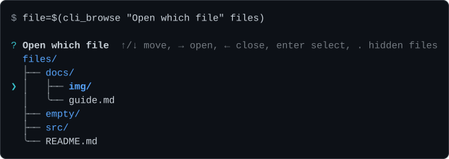

# cli.sh

One file that makes shell scripts pleasant to use: coloured messages, lists and tables, progress bars,
spinners, timers, arrow-key selectors, commands with generated help pages, and an interactive mode.

It writes for whoever is reading. A person at a terminal gets colour and animation. A pipe or a log
file gets the same words without escape codes. An LLM agent gets the fewest tokens that still carry
the information.

- One file, about 92 KB. No dependencies beyond a shell and the usual Unix tools.
- Works in bash 3.2+ (the bash that ships with macOS) and zsh 5.3+.
- Safe under `set -euo pipefail`.
- Usable from any language: `./cli.sh select "Pick one" a b c` runs a single function.

## Install

Copy `cli.sh` into your project and source it:

```sh
. "$(dirname "$0")/cli.sh"
```

## A first script

```sh
#!/usr/bin/env bash
set -euo pipefail
. "$(dirname "$0")/cli.sh"

cli_require git tar

cli_steps 3
cli_step "Fetch"
cli_spin "Pulling the latest changes" git pull --quiet

cli_step "Pack"
files=(src/*)
i=0
for f in "${files[@]}"; do
  i=$((i + 1))
  cli_progress "$i" "${#files[@]}" "Packing"
done

cli_step "Ship"
target=$(cli_select -d staging "Deploy to" staging production)
if cli_confirm "Deploy to $target?" n; then
  cli_ok "Deployed to $target"
fi
```

`examples/todo.sh` is a small app with commands.

## Try it

`examples/demo.sh` runs every feature and prints the code behind each one.

```sh
examples/demo.sh                  # a menu of sections (in a terminal)
examples/demo.sh all              # every section, top to bottom
examples/demo.sh prompts          # one section
examples/demo.sh mock             # a pretend release that uses most features together
examples/demo.sh mock --fail      # the same, with failing tests
examples/demo.sh compare lists    # one section in rich, plain and agent mode

CLI_MODE=plain examples/demo.sh all    # what a log file gets
CLI_AGENT=1    examples/demo.sh all    # what an LLM gets
```

## The three modes

| Mode | When | What you get |
|---|---|---|
| `rich` | stdout and stderr are a terminal | colours, symbols, animation, key-driven prompts |
| `plain` | pipes, files, CI, `TERM=dumb` | the same words, no escape codes, no animation |
| `agent` | `CLI_AGENT=1`, `--agent`, or an agent harness is detected | only what is needed |

The mode is chosen once, when the file is sourced. `cli_mode` prints it; `cli_mode agent` (or `rich`,
`plain`, `auto`) changes it and exports the choice to child scripts.

Status lines (`cli_info`, `cli_ok`, progress, the prompt UI) go to stderr. Content (lists, tables,
help pages, the answers to prompts) goes to stdout, so `choice=$(cli_select ...)` and
`mytool list | grep x` both work.

### Agent mode

The same script, read by an LLM:

| Call | rich | agent |
|---|---|---|
| `cli_ok "Built"` | `✓ Built` (green) | `ok: Built` |
| `cli_info "3 files"` | `● 3 files` | `3 files` |
| `cli_header "Report"` | bold title with a rule | `# Report` |
| `cli_table "Name\|Role" "Ana\|dev"` | aligned columns, bold header | tab-separated rows |
| `cli_box`, `cli_hr`, `cli_nl`, `cli_hint` | drawn | text only, or nothing |
| `cli_progress` | a live bar, then `✓ Copying (20/20, 1.1s)` | one line at the end: `Copying: 20/20 1.1s` |
| `cli_tasks`, `cli_task` | a bar per task over a bar for the whole | failures, then `Backup: 4/4 12s` |
| `cli_spin "Build" make` | spinner, then `✓ Build (4.2s)` | `ok: Build (4.2s)` |
| a failing `cli_spin` | the command's whole output | its last 40 lines |
| `cli_select "Env" a b` | arrow-key menu | reads one line of stdin, never blocks |
| `mytool help` | sectioned help page | every command and option in one compact page |

Prompts never hang an agent. They take an answer from stdin if one is there within a second, then
fall back to the default, then fail with a message that says what to send:

```
error: input required: Deploy to (options: staging | production). Pipe the answer on stdin.
```

Agent mode turns on by itself when one of these is set: `CLAUDECODE`, `CURSOR_AGENT`, `GEMINI_CLI`,
`CODEX_SANDBOX`, `OPENCODE`, `AI_AGENT`, `AGENT`. `CLI_AGENT=0` turns that detection off, and
`CLI_AGENT=1` is the reliable way to ask for it.

## Functions

Run `./cli.sh` for this list with each function's arguments.

**Messages** (stderr)

| | |
|---|---|
| `cli_info`, `cli_ok`, `cli_warn`, `cli_error` | a status line |
| `cli_debug` | shown only with `CLI_DEBUG=1` |
| `cli_die TEXT [CODE]` | print an error and exit |
| `cli_hint` | a tip for humans; agents never see it |
| `cli_steps N`, `cli_step TEXT` | `[2/5] Build` |
| `cli_exec CMD...` | print `$ cmd`, then run it |

**Layout and data** (stdout)

| | |
|---|---|
| `cli_header TITLE`, `cli_hr`, `cli_nl` | structure |
| `cli_box [-t TITLE] LINE...` | text in a frame |
| `cli_list [-n] ITEM...` | bullets, or numbers with `-n` |
| `cli_kv KEY VALUE...` | aligned `key: value` lines |
| `cli_table [-s SEP] [-a ALIGN] [-b] [-H] HEADER ROW...` | columns; cells split on `\|` by default |
| `cli_timeline [-v] [-r] [-s SEP] ROW...` | events on tracks, along a time axis or one per row |
| `cli_tree [-d DEPTH] [-s SEP] ROW...` | a tree of paths; a row is `PATH\|NOTE` |
| `cli_tree [-a] [-d DEPTH] -p DIR` | the files under a directory as a tree |
| `cli_indent [N]` | indent stdin |
| `cli_style "bold red" TEXT` | styled text, plain when colours are off |

Tables align themselves: a column that holds only numbers goes to the right, the rest to the left.

```sh
cli_table "Item | Qty | Price" "Apple | 3 | 1.20" "Melon | 12 | 10.00"   # numbers right-aligned
cli_table -a lcr "Name | Role | Since" "Ana | dev | 2019"                # left, centred, right
cli_table -b "Name | Role" "Ana | dev"                                   # with borders
cli_table -H "config | ~/.config/app.toml" "cache | ~/.cache/app"        # no header: aligned columns
```

At a terminal, a table wider than the screen has its widest column cut, with `…` at the end.

A timeline shows events over time. Each row is `WHEN | TRACK | LABEL | FROM`: a track is whatever
the events belong to (a device, a branch, an album), and `FROM` is optional and names the track
that this event continues or merges.

```sh
cli_timeline "2024-02-01 | iPhone 12 | 38.7 GB" \
             "2024-07-11 | iPad      | 11.9 GB" \
             "2025-06-01 | iPhone 15 | continues iPhone 12 | iPhone 12" \
             "2026-09-14 | iPhone 15 | combined with iPad  | iPad"
```

```
             2024                    2025                    2026
  iPhone 12  ●───────────────────────────────╮
  iPad                 ●─────────────────────┼──────────────────────────────╮
  iPhone 15                                  ●──────────────────────────────●
```

That view is as wide as the terminal and has no room for the labels. `-v` gives one row per
event instead: it is as long as it needs to be, so the history scrolls. `-r` puts the newest on
top.

```sh
git log --date=short --format='%ad%x09main%x09%s' | cli_timeline -v -r -s "$(printf '\t')"   # tab-separated
```

```
  ●      2024-02-01  iPhone 12  38.7 GB
  │ ●    2024-07-11  iPad       11.9 GB
  ╰─┼─●  2025-06-01  iPhone 15  continues iPhone 12
    ╰─●  2026-09-14  iPhone 15  combined with iPad
```

`WHEN` is a date (`2026-03-14`, with `09:30` or `09:30:00` after it if you like), a whole number,
or any text. Dates and numbers are sorted and spaced by their value, and the axis labels itself
in years, months, days or hours. With text, rows keep the order you gave them. An agent gets
the events in order as tab-separated rows.

A tree shows anything that nests. Give it paths, each with a note if you like, or point it at a
directory:

```sh
cli_tree "src/main.rs | 1.2 KB" "src/lib/x.rs" "src/lib/y.rs | 300 B" "README.md | readme"
git ls-files | cli_tree -d 2          # two levels; a directory with more inside ends in …
cli_tree -p .                         # the files here: directories first, hidden ones with -a
```

```
src/
├── main.rs   1.2 KB
╰── lib/
    ├── x.rs
    ╰── y.rs  300 B
README.md     readme
```

Paths that share a directory are shown together, in the order they first appear; a path that
ends in `/` is a directory even when nothing is in it. An agent gets one name per line, indented
by one space per level. `cli_browse` (under Prompts) lets a person walk through the same trees.

`cli_box`, `cli_list`, `cli_table`, `cli_timeline` and `cli_tree` read lines from stdin when given no arguments. The variables
`$CLI_RED`, `$CLI_BOLD`, `$CLI_RESET` and friends hold the colour codes, and are empty when colours
are off.

**Time**

| | |
|---|---|
| `cli_timer_start [NAME]`, `cli_timer_elapsed [NAME]`, `cli_timer_ms [NAME]` | stopwatches |
| `cli_time LABEL CMD...` | run a command and report how long it took |
| `cli_countdown SECONDS [LABEL]` | wait, showing the seconds left |
| `cli_duration MS` | `340ms`, `4.2s`, `3m 07s`, `1h 02m` |
| `cli_size BYTES` | `512 B`, `1.5 KB`, `27.9 GB` |

**Progress**

| | |
|---|---|
| `cli_progress CURRENT TOTAL [LABEL]` | call it in your loop; at TOTAL the bar becomes one `✓` line |
| `cli_progress_done` | end the bar early |
| `cli_tasks [-t SECONDS] TITLE [NAME\|WEIGHT\|SHOW]...` | several tasks under one total: name them |
| `cli_task [-t SECONDS] NAME [CURRENT TOTAL]` | a task is running; at TOTAL it is done |
| `cli_task_note NAME [TEXT]` | a few words next to a running task |
| `cli_task_done [-t SECONDS] NAME`, `cli_task_fail NAME [TEXT]` | how a task ended |
| `cli_tasks_done` | end the group; exit status 1 if a task failed |
| `cli_spin LABEL CMD...` | spinner while the command runs; its output shows only if it fails |

`cli_spin` runs the command in the current shell, so it can be one of your own functions.

**Several tasks, one total.** A job in stages, or jobs running side by side, with a bar for the
whole. Give each task a weight if they are not the same size:

```sh
cli_tasks "Backup" "Scan | 1" "Photos | 6" "Messages | 2" "Verify | 1"
cli_task Scan;  scan_device;  cli_task_done Scan        # no count: a spinner and the time
for i in $(seq 1 "$n"); do copy_photo "$i"; cli_task Photos "$i" "$n"; done   # done at $n
cli_task_fail Messages "database is locked"             # shown next to the task
cli_tasks_done || cli_die "The backup is not complete"
```


A task can show more than `60/120`. The third cell of its row says what: `bytes` for sizes,
`rate` for speed, `eta` for the time left, `percent` for a task that knows nothing but a
percentage. `cli_task_note` adds what it is doing right now:

```sh
cli_tasks "Copy" "Photos | 6 | bytes rate eta" "Phone | 1 | percent"
cli_task Photos "$done" "$size"          # Photos  ████░░░  33%  10.9 GB/32.8 GB  11.2 MB/s  33m 20s left
cli_task_note Phone "verifying"          # Phone   ██░░░░░  37%  verifying
```

When the work was already running before your script looked, give the times you know:
`cli_tasks -t 3600 ...` (the group started an hour ago), `cli_task -t 90 NAME ...` (this task
90 seconds ago), `cli_task_done -t 842 NAME` (it took 14m 02s).

Update several tasks in turn and they move side by side. For work that really runs at the same
time, let each background job write `CURRENT TOTAL` to a file, and report from the main script:

```sh
cli_tasks "Sync" iPhone iPad
sync_device iPhone "$tmp/iPhone" & a=$!       # each job writes "37 200" to its file
sync_device iPad "$tmp/iPad" & b=$!
report() {
  for device in iPhone iPad; do
    if [ -f "$tmp/$device" ]; then read -r cur total <"$tmp/$device"; cli_task "$device" "$cur" "$total"; fi
  done
}
while kill -0 "$a" 2>/dev/null || kill -0 "$b" 2>/dev/null; do report; sleep 0.2; done
report                                # what the jobs wrote last
cli_tasks_done
```

The jobs should write to another name and rename it, so that a half-written file is never read.
A task that has ended ignores later updates, so reporting it again does no harm.

A log gets one line per finished task and one each time the total passes a quarter; an agent
gets the failures and one line at the end.

**Prompts** (UI on stderr, answer on stdout)

| | |
|---|---|
| `cli_select [-d DEFAULT] QUESTION OPTION...` | pick one with the arrow keys (or Tab and Shift-Tab) |
| `cli_multiselect [-d DEFAULT]... QUESTION OPTION...` | pick several with space; one per line |
| `cli_confirm [-p] QUESTION [y\|n]` | exit status 0 for yes, 1 for no; `-p` prints `yes` or `no` instead |
| `cli_input [-c CANDIDATE]... QUESTION [DEFAULT]` | a line of text; Tab steps through the candidates |
| `cli_browse [-a] [-d] QUESTION [DIR]` | walk through the files under `DIR` and pick one; `-d` picks a directory |
| `cli_browse -l [-d] [-s SEP] QUESTION ROW...` | the same over a list of paths (`PATH\|NOTE` rows) |
| `cli_password QUESTION` | hidden typing, also when the output is piped |
| `cli_pause [TEXT]` | wait for a key |
| `cli_wizard FUNCTION...` | ask questions in order; Escape goes back one |

Without a terminal the selectors print numbered options and read one line, which may be a number
or the option's text (`printf 'production\n' | ./deploy.sh`). `CLI_YES=1` answers yes to every
`cli_confirm`.

**Walking through files.** `cli_browse` shows a tree that opens and closes under the cursor, and
prints the path that was chosen:

```sh
file=$(cli_browse "Open which file" ~/Documents)
dir=$(cli_browse -d "Restore to")                                      # a directory, starting here
item=$(cli_browse -l "Restore what" "Photos/2024/a.jpg | 2 MB" "Notes/todo.txt | 4 KB")
```



Right opens a directory and left closes it; left on the top directory shows the one above it, so
you can walk anywhere. Enter picks a file (or opens and closes a directory), `.` shows hidden
files, Escape cancels. With `-l` the tree comes from a list of paths instead of the disk: the
contents of an archive or a backup, say. Without a terminal it reads the path from stdin and
checks it: `echo todo.txt | cli_browse "Open which file" ~/Documents`.

**Suggestions.** `cli_input -c main -c dev -c release "Branch"` lets the person type anything, and
Tab and Shift-Tab step through the candidates that start with what was typed, shown on a row
underneath. Escape puts back what was typed.

**Going back.** Escape cancels a question with exit status 3. `cli_wizard` uses that to step back:

```sh
ask_name() { name=$(cli_input "Your name" "${name:-}"); }
ask_env()  { env=$(cli_select -d "${env:-staging}" "Deploy to" staging production); }
ask_sure() { sure=$(cli_confirm -p "Go ahead?" y); }

cli_wizard ask_name ask_env ask_sure || cli_die "Cancelled"
```

Each function asks one question and offers the earlier answer as the default, so going back shows
what was chosen. Escape on the first question ends the wizard.

Ctrl-C during any of these leaves the terminal the way it was.

**Other**: `cli_has CMD`, `cli_require CMD...`, `cli_mode`, `cli_is_agent`, `cli_width` (the terminal's columns), and
`cli_legacy_aliases`, which defines the function names of the old `sh-utils` (`success`, `error`,
`log_info`, `command_exists`, ...). Unlike the old ones, messages go to stderr.

## Commands and help pages

```sh
cli_app todo "A tiny todo list" 1.0.0
cli_opt "-v, --verbose" "Say more"                  # before any cli_cmd: a global option

cli_cmd add "Add a task"                            # runs cmd_add
cli_args "<text>"
cli_opt "-p, --priority <n>" "1 (high) to 3 (low)" 2
cli_example 'todo add "Buy milk" -p 1'

cli_cmd list "Show the tasks" show_tasks            # or name the function yourself

cmd_add() {
  echo "adding '$1' with priority $opt_priority"
}

cli_run "$@"
```

`cli_run` gives you:

- `todo`, `todo help`, `todo --help`: the help page. `todo help add`, `todo add --help`: one command's.
- Options parsed into `$opt_<name>`. `-p 1`, `--priority 1` and `--priority=1` all set
  `$opt_priority`. A flag without a value, such as `--dry-run`, sets `$opt_dry_run` to `1`.
  The function receives the remaining arguments as `"$@"`. `--` ends option parsing.
- Errors for unknown commands (with a suggestion) and unknown options. Exit status 2.
- `--version`, `--agent`, `--plain`, `--no-color`, before the command name.
- `todo -i`: interactive mode. Type commands at a prompt. Tab and Shift-Tab step through the
  commands, and after a command through its options; up and down recall earlier lines; Enter on an
  empty line opens a menu. Piped input works too: `printf 'add x\nlist\n' | todo -i`.

A command that declares no options, in an app with no global options, receives its arguments
untouched, so it can do its own parsing.

## Environment

| Variable | Effect |
|---|---|
| `CLI_MODE=rich\|plain\|agent` | force a mode |
| `CLI_AGENT=1` / `0` | force agent mode / never detect it |
| `NO_COLOR=1` | keep the layout, drop the colours |
| `FORCE_COLOR=1` | rich mode without a terminal |
| `CLI_QUIET=1` | only warnings and errors |
| `CLI_DEBUG=1` | show `cli_debug` lines |
| `CLI_YES=1` | `cli_confirm` answers yes |
| `CLI_INTERACTIVE=0` | numbered line prompts instead of key-driven menus |
| `CLI_PAGE=10` | rows a selector shows before it scrolls |

## Limits

- Text given to `cli_box`, `cli_table`, `cli_timeline` and `cli_tree` must be plain: colour codes inside it
  break the alignment. Wide characters (CJK, emoji) count as one column.
- A timeline does not know time zones or calendars other than the Gregorian one: the zone in
  `2026-03-14T09:30+01:00` is read and ignored.
- Along the axis, a link between two events that fall in the same column is hidden by them.
- `cli_tree` and `cli_browse -l` use `awk` to sort the paths into a tree.
- `cli_tree -p` does not follow symbolic links to directories; `cli_browse` opens them when asked.
- A tree does not mark what a directory holds before it is opened, and a file name with a
  newline in it breaks the drawing.
- While a bar or a group of tasks is on the screen, status lines (`cli_info`, `cli_warn`,
  `cli_hint`, ...) go above it. Anything else (`cli_table`, a command's own output) lands in the
  middle of it: finish the bar first, or keep that output for afterwards.
- At a terminal a group of tasks redraws at most every 80 ms, except on bash 3.2, which has no
  clock that fine and draws on every call.
- A group of tasks belongs to one shell process: a background job cannot call `cli_task` for it.
- Short options cannot be combined: write `-a -b`, not `-ab`.
- bash 3.2 has no sub-second clock, so durations there are in whole seconds.
- On bash 3.2 the Escape key takes a second to register.
- A line longer than the terminal is wide confuses the line editor.
- `cli_spin` hides the command's output while it runs. For a command whose output matters, use
  `cli_exec` or `cli_time`.
- No PowerShell support.

## Tests

```sh
test/all.sh             # unit tests and the shared conformance cases, in every shell found
bash test/test.sh       # the unit tests in one shell
bash test/conform.sh    # ../conformance/cases.txt in one shell
```

The output of every function is part of a contract shared with the other implementations in this
repository: see `../SPEC.md`.
